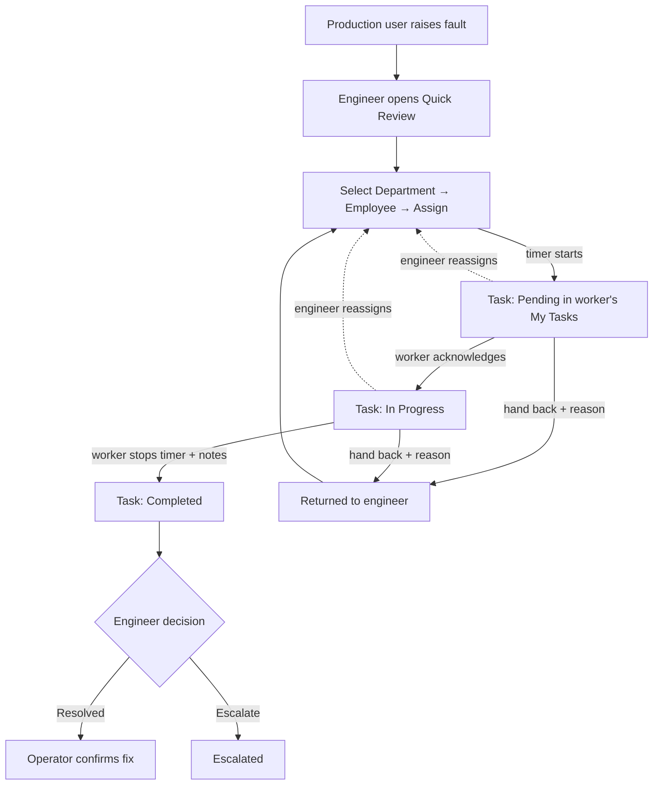

# Worker Task Assignment Module

**Status:** Planned, not implemented yet
**Date:** 2026-10-19

## 1. Purpose

Today, an engineer on the Quick Review page clicks **Start Working**. This starts a timer, but the timer is always for the engineer who clicked. There is no way to say *who actually fixes the fault*, and the person doing the work has no view of their own tasks.

This module adds:

- **Assignment.** The engineer chooses a **Department** and then an **Employee** in that department. The timer starts when the task is assigned.
- **A worker task list.** Each worker gets a **My Tasks** page with **Pending**, **In Progress** and **Completed** tabs.
- **Worker actions.** The worker acknowledges the task, then stops the timer when finished, or hands it back with a reason.
- **Return to the engineer.** The ticket comes back to the engineer, who makes the final decision as today.

## 2. End-to-end flow

### Decisions agreed

| Topic | Decision |
|---|---|
| Departments offered for assignment | Only departments of type **MAINTENANCE** or **SERVICES** (e.g. Electrical, Mechanical, Civil, Process Automation, HSE, Fire and Safety, General Management). Production departments are hidden. |
| What is recorded | Both the **worker** doing the job and the **engineer who assigned** it |
| When the timer starts | At assignment |
| When the worker finishes | The ticket goes **back to the engineer**, who chooses Resolved (the operator then confirms) or Escalate |
| Worker can't do the task | The worker can **hand it back with a reason**, and the engineer reassigns it |
| Reassigning | The engineer can **reassign** an unfinished task. The old task is closed as *Reassigned*. |

## 3. Task states

Each assignment is one task (one `WorkSession` record).

| Task status | Meaning | Shown to worker under | Timer |
|---|---|---|---|
| `ASSIGNED` | Assigned, waiting for the worker to acknowledge | Pending | Running |
| `ACKNOWLEDGED` | The worker confirmed they are working on it | In Progress | Running |
| `COMPLETED` | The worker stopped the timer | Completed | Stopped |
| `RETURNED` | The worker handed it back with a reason | Completed (badge "Returned") | Stopped |
| `REASSIGNED` | The engineer moved it to someone else | Completed (badge "Reassigned") | Stopped |

The ticket (`MachineIssue`) stays **In Progress** from assignment until the engineer makes a decision.

## 4. Data model changes

**File:** `core/models.py`, model `WorkSession`

Existing fields stay as they are. `engineer` now means **the assigned worker**, so the current timer card, complaint-tracking history and admin keep working.

New fields:

| Field | Type | Purpose |
|---|---|---|
| `task_status` | Choice (see section 3), default `ASSIGNED` | The worker's task lifecycle |
| `started_by` | FK → Employee, nullable | The engineer who assigned the task |
| `acknowledged_at` | DateTime, nullable | When the worker acknowledged it |
| `worker_notes` | Text, nullable | Completion notes, or the reason for handing back |

Other model changes:

- **New `outcome` values:** `RETURNED` and `REASSIGNED`. A task whose outcome is `IN_PROGRESS` is still the ticket's *current* task, so the existing "active session" checks keep working.
- **New helper methods:** `acknowledge()`, `finish(notes)`, `hand_back(reason)` and `reassign()`. Each one sets the timestamps, the duration and the statuses.
- **`complete()` keeps the worker's times.** It no longer overwrites the worker's finish time or duration. The engineer's decision only records the outcome and comments.

**Migration:** `0029_worksession_task_fields`. It only adds fields; the table is currently empty after the test-data wipe.

## 5. Engineer side

### Quick Review page

**File:** `maintenance/templates/maintenance/quick-review.html`

| Ticket state | What the engineer sees |
|---|---|
| No task yet | A **Department** dropdown, an **Employee** dropdown (filtered by department) and an **Assign & Start Timer** button. If the last task was handed back, a banner shows "Returned by *name*: *reason*". |
| Task assigned or acknowledged | A live timer card with the worker's name and department, "Waiting for acknowledgement" or "Working since *time*", and who assigned it. A **Reassign** option opens the same dropdowns. Decision buttons are hidden. |
| Task completed by the worker | The stopped timer with the total time and the worker's notes, plus the existing **Resolved / Escalate** decisions |

### Server changes

**File:** `maintenance/views.py`

**New endpoint, employees by department**
- Returns the employees of one department as JSON: id, name and designation.
- Only works for MAINTENANCE/SERVICES departments.
- Requires login and engineer permission.

**`start_working` becomes "assign"**
- **Input:** a department and an employee.
- **Validation:** the employee must belong to the department, and the department must be an allowed type. Otherwise it returns an error.
- **Result:** creates the task (worker, assigned by, status `ASSIGNED`) and sets the ticket to In Progress.
- **If an unfinished task already exists:** it answers "already assigned", unless the request is a reassign. In that case the old task is closed as `REASSIGNED` first.
- **Access:** restricted to engineers (`core.can_review_complaint` or the Engineers group).

**`quick_review`** also passes:
- the allowed departments, with the engineer's own department pre-selected;
- whether the current task is completed;
- the last handed-back task, if any.

## 6. Worker side: My Tasks

**New page:** `my-tasks/`, template `maintenance/templates/maintenance/my-tasks.html`

- **Who can open it:** any logged-in employee. They only see tasks assigned to themselves.
- **Tabs, each with a count:**
  - **Pending:** tasks to acknowledge;
  - **In Progress:** acknowledged and being worked on;
  - **Completed:** completed, returned or reassigned tasks from the last 30 days.
- **Each task card shows:**
  - the ticket number, equipment and machine;
  - the operator's description and photos, and the selected fault;
  - who assigned it and when;
  - a live timer (a fixed time once finished).

### Worker actions

All actions only work on the worker's own task, and only in the right state.

| Action | From state | Result |
|---|---|---|
| **Acknowledge** | Pending | Moves to In Progress; records the acknowledgement time |
| **Stop timer / Complete** (with optional notes) | In Progress | Moves to Completed; records the finish time and duration. The ticket goes back to the engineer. |
| **Hand back** (reason required) | Pending or In Progress | Moves to Returned; the engineer sees the reason and reassigns |

### Navigation

- A **My Tasks** link in the main navbar (`templates/index.html`) for every employee.
- It has a badge showing the number of pending tasks, supplied by a small context processor next to the existing sidebar one (`User/context_processors.py`).

## 7. Other screens updated

- **Operator's complaint tracking** (`User/templates/user/complain-tracking.html`): the work history shows the worker, department, task status, and their notes or reason for handing back.
- **Engineer ticket list** (`maintenance/templates/maintenance/complain-view.html`): no change. Quick Review is still the entry point for Pending and In Progress tickets.
- **Django admin** (Work sessions): adds task status and "assigned by" to the list and filters.

## 8. Files affected

| File | Change |
|---|---|
| `core/models.py` | New `WorkSession` fields and methods |
| `core/migrations/0029_worksession_task_fields.py` | New migration |
| `core/admin.py` | Work session list columns and filters |
| `maintenance/views.py` | Employees-by-department endpoint, assign/reassign, My Tasks page and worker actions |
| `maintenance/urls.py` | New routes |
| `maintenance/templates/maintenance/quick-review.html` | Assignment dropdowns, task states, reassign |
| `maintenance/templates/maintenance/my-tasks.html` | New worker page |
| `templates/index.html` | My Tasks navbar link with badge |
| `User/context_processors.py` (+ settings registration) | Pending-task count |
| `User/templates/user/complain-tracking.html` | Richer work history |

## 9. Testing plan

Run the checks and migration (`check`, `makemigrations --check`, `migrate`). Then run an automated walkthrough with test data that is rolled back afterwards:

1. A production user raises a ticket. An engineer opens Quick Review, which lists only MAINTENANCE/SERVICES departments.
2. **Assignment checks:**
   - The employee list for a department contains only that department's people.
   - An employee from the wrong department is rejected.
   - A valid assignment creates a Pending task and sets the ticket to In Progress.
3. **Repeat and reassign:**
   - Assigning again answers "already assigned".
   - Reassigning closes the old task as Reassigned and creates a new Pending one.
4. **As the worker:**
   - The task appears under Pending.
   - Another user cannot act on it.
   - Acknowledge moves it to In Progress.
   - Complete with notes moves it to Completed, with a duration recorded.
5. **As the engineer:** the decisions now appear. Choosing Resolved sends the ticket to the operator for confirmation, and the worker's finish time and duration are kept.
6. **Hand-back path:** the worker hands back with a reason. The engineer sees the reason banner and can assign again.
